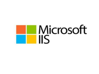
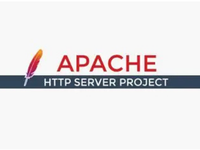
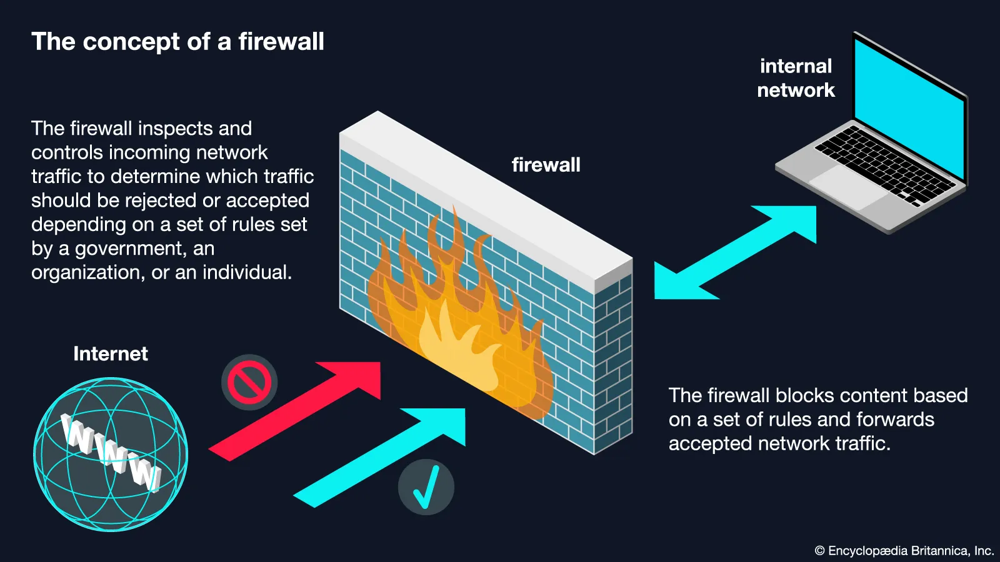

# Deliverable 1

## Questions 

### 1. What is a web server?(In the context of software Ex. Apache)
(https://nginx.org/)
* A web server is a computer that stores websites and sends them to your browser when you ask for it

### 2.What are some different web server applications? Include definitions project’s website/where to download it, which operating system is available for and its latest version.

#### Application 1

A modern open-source web server, written in Go,that sets up HTTPS automatically

* Website: [caddyserver](https://caddyserver.com/)
* Available for: Windows, Mac,Linux,BSD,and Android.
* Latest Version: The latest version is 2.11.4

#### Application 2

Microsoft's web server,built into Windows

| Website                           | Availability | Latest version |
| --------------------------------- | ------------ | ------------- |
| [Application 2](https://www.iis.net/)| Windows 10 and 11 |10.0    |

#### Application 3

One of the oldest and most popular open-source web servers, and very customizable

* Website: [Apache HTTP](https://httpd.apache.org/download.cgi)
* Available for: Linux and Unix. Windows third-party
* Latest Version: 2.4.68

### 3. What is virtualization?
Virtualization is using software to run a pretend computer, called a virtual machine, inside your real computer. For example, you can run Linux in a window on your Windows laptop without affecting your real system. 

### 4. What is virtualbox?
VirtualBox is a free program that lets you create and run virtual machines on your computer. For example, you can use it to run Linux or another version of Windows in a window on your own computer, and it works on Windows, Mac, and Linux. 

### 5. What is a virtual machine?
A virtual machine (VM) is a pretend computer that runs as a program inside your real computer. It has its own operating system and apps, and it stays separate from your real system, so what happens inside it doesn’t affect the real computer.

### 6. In the context of virtualization, what does host machine and guest machine mean?
* **Host machine**: the real, physical computer that runs the virtualization software, like your laptop.

* **Guest machine**: the virtual machine running inside the host, like a Linux VM on your Windows laptop.

### 7.What is Debian?
Debian is a free, open-source Linux operating system. It’s known for being stable and reliable, and it’s the base for other popular systems like Ubuntu. 

### 8.What is a firewall?

A firewall is a security tool that watches the traffic going in and out of a computer or network and blocks anything unsafe based on a set of rules. It works like a security guard at a door, letting trusted traffic through and keeping suspicious traffic out. 

### 9.What is SSH?
SSH (Secure Shell) is a way to safely connect to another computer over a network and control it by typing commands. It encrypts everything you send, so no one can spy on it, which makes it a common way to manage servers remotely. 

### 10.What is an IP Address?
An IP address is a unique number that identifies a device on a network, like the internet. It works like a home address, so data knows where to go. An example is 192.168.1.1.

### 11.What is a network mask?
A network mask (also called a subnet mask) is a number that splits an IP address into two parts: the part that identifies the network and the part that identifies the device on it. For example, with the mask 255.255.255.0, the first three numbers of 192.168.1.10 name the network and the last number names the device. 

### 12.What is a port? (in the context of networking/computers)
A port is a numbered “door” on a computer that lets a specific program or service send and receive network traffic. The IP address finds the computer, and the port number finds the right program on it. For example, web servers usually use port 80 for HTTP and port 443 for HTTPS, and SSH uses port 22.

### 13.What is port forwarding?
Port forwarding is a setting that sends network traffic arriving at one port on a router or host to a specific port on another device. For example, you can forward port 80 on your router to a web server inside your network, so people outside can reach it. In VirtualBox, it’s often used to reach a virtual machine from the host, like forwarding a host port to the VM’s port 22 to use SSH.

### 14.What is localhost? (in the context of networking/computers)
Localhost is a name that means “this computer,” the one you’re using right now. When you go to localhost, your computer talks to itself instead of going out to the internet.

### 15.What does this ip address represent 127.0.0.1?
It’s the IP address for localhost, also called the loopback address. Traffic sent to it never leaves your computer, which makes it handy for testing a web server you’re running yourself.

### 16.What is Git?
Git is a free tool that tracks changes to your files, usually code. It saves a history of every version, so you can go back to an earlier one if something breaks, and many people can work on the same project without overwriting each other.

### 17.What is GitHub?
GitHub is a website that stores Git projects online so you can back them up, share them, and work on them with others. Git is the tool that tracks the changes, and GitHub is the place where those projects are hosted.

## Concept I did not understand 
1. **NAT vs. Bridged networking:** NAT hides the VM behind your computer, while Bridged gives it its own IP address on your network.
2. **Port forwarding numbers:** You connect to host ports like 2222 (SSH) or 8080 (web), which get sent to the VM's ports 22 and 80.
3. **127.0.0.1 (localhost):** It means "this computer," so inside the VM it points to the VM, but on your host it points to your host 