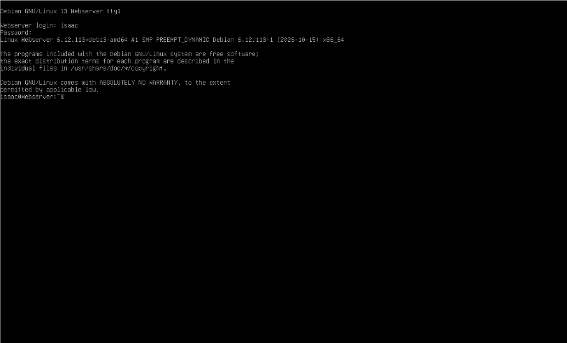

# Server Hardware specifications

# Debian Login screen

# IP address debian server

# How to work with the Firewall 
* **Description**: In Debian, the firewall is managed with **ufw** (Uncomplicated Firewall). It controls which network traffic is allowed in or out of the system by turning the firewall on or off and adding or removing rules.

* **Formula**/**Syntax**: `sudo ufw` + `action` + `argument`
* `sudo ufw` is the command (run with admin rights)
* `action` is what to do, such as `status`, `enable`, `disable`, or `allow`
* `argument` is what the action applies to, such as an application profile like `'WWW Full'`
* **Examples**:

* How do you check if the Firewall is running?
* By using the command `sudo ufw status`, which shows whether the firewall is active or inactive and lists the rules. You can also use `systemctl status ufw` to check the ufw service.

* How do you disable the Firewall?
* By using the command `sudo ufw disable`, which turns the firewall off so no rules are enforced.

* How do you add Apache to the Firewall?
* By using the command `sudo ufw allow 'WWW Full'`, which allows web traffic on ports 80 (HTTP) and 443 (HTTPS).

# What different commands to use to work with Apache2

**1.  What is the command you use to check if Apache is running?**
* The command is: `systemctl status apache2`
* What it does: shows whether the Apache service is `active (running)` or `inactive (dead)`, along with its most recent log lines.

**2.  What is the command you use to stop Apache?**
* The command is: `sudo systemctl stop apache2`
* What it does: shuts down the Apache service so the website no longer loads. It prints nothing when it works.

**3.  What is the command you use to restart Apache?**
* The command is: `sudo systemctl restart apache2`
* What it does: stops Apache and starts it again. This applies configuration changes or turns Apache back on after it was stopped.

**4.  What is the command used to test Apache configuration?**
* The command is: `sudo apache2ctl configtest`
* What it does: checks the Apache configuration files for errors without restarting the server. `Syntax OK` means the configuration is valid.

**5.  What is the command used to check the installed version of Apache?**
* The command is: `sudo apache2 -v`
* What it does: prints the installed Apache version number and the date it was built.

**6.  What are some common configuration files for Apache?**
* The command is: `ls /etc/apache2/`
* What it does: lists the files and folders in Apache's configuration directory. Common ones are `apache2.conf` (main configuration), `ports.conf` (ports Apache listens on), `sites-available` (virtual hosts), `mods-available` (modules) and `conf-available` (extra settings).

**7.  Where does Apache store logs?**
* The command is: `sudo ls /var/log/apache2/`
* What it does: lists the files in the Apache log directory, `/var/log/apache2/`. It contains `access.log` (requests to the server) and `error.log` (errors). `sudo` is needed because the folder is restricted.

**8.  What are some basic commands we can use to review logs?**
* The command is: `sudo tail -f /var/log/apache2/access.log`
* `tail -f` follows the log live, showing new entries as they are written.
