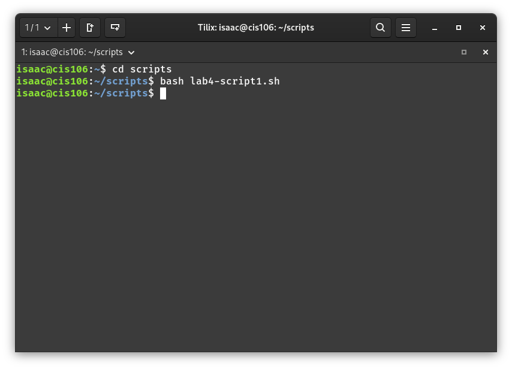
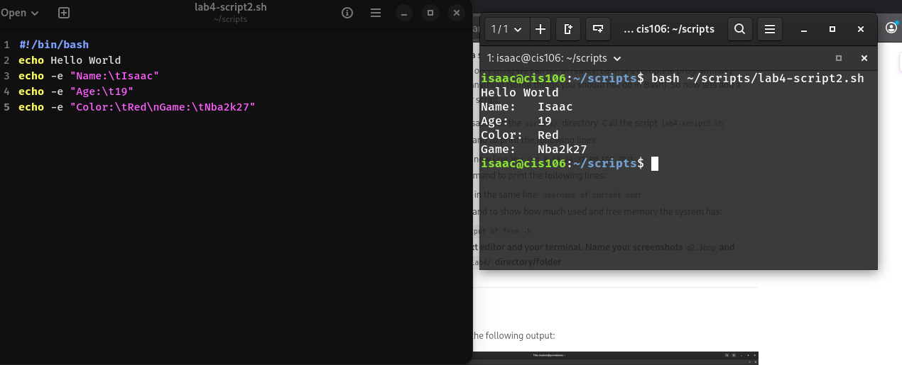
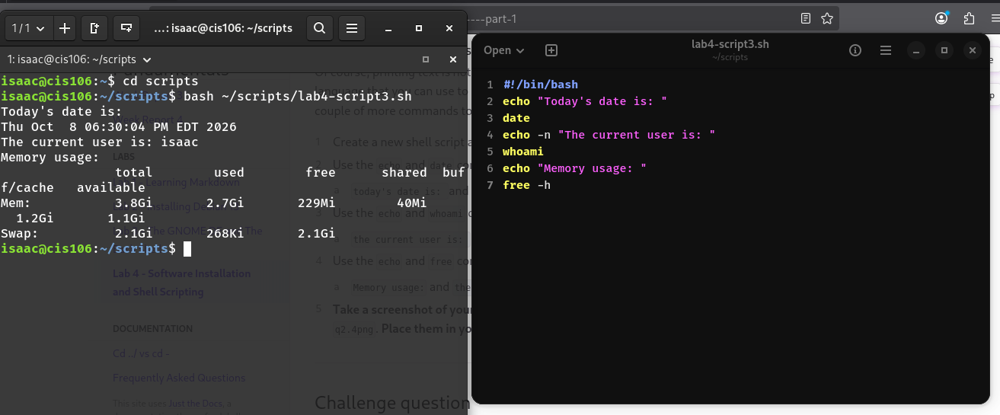
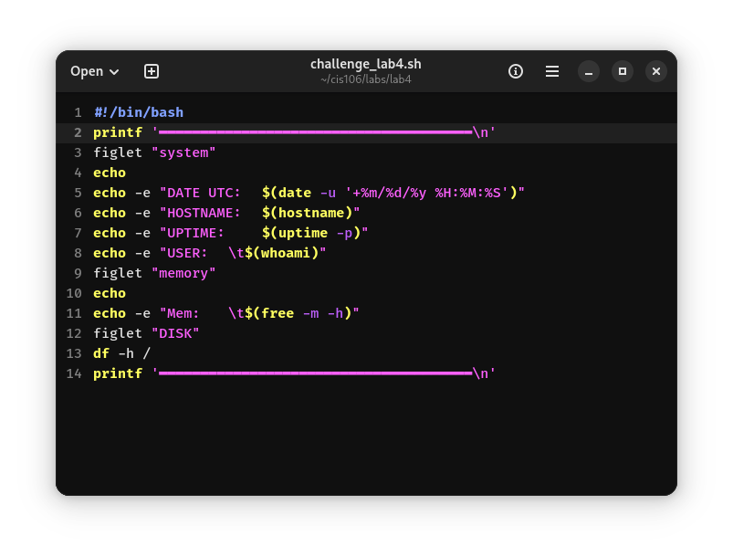
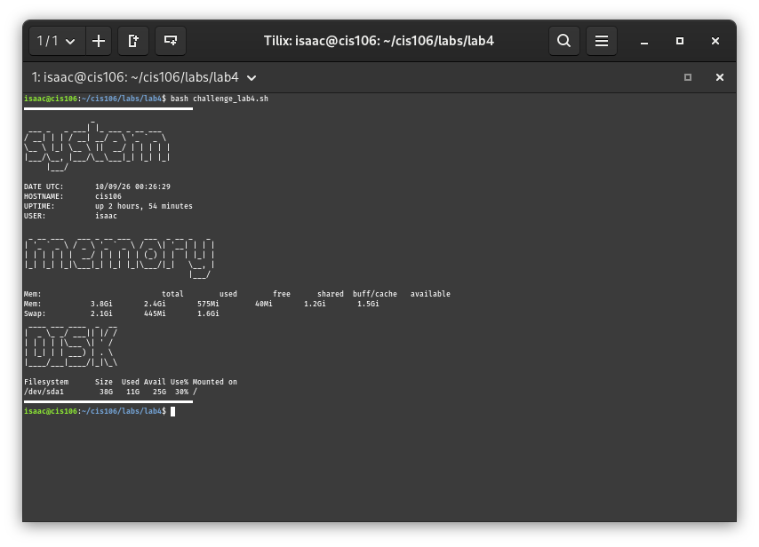

# How to install and remove software using the APT command. Include several well documented examples as you will need to install software later.

* **What APT is:** It's the tool Ubuntu, Debian, and Mint use to install software. Most commands need `sudo` because they change the system.
* **Always update first:** `sudo apt update` refreshes the list of available software. It doesn't install anything by itself.
* **Installing a program:** `sudo apt install <package-name>`
  * Example: `sudo apt install tree`
  * Type `y` when it asks if you want to continue
* **Skipping the prompt:** Add `-y`, like `sudo apt install -y htop`
* **Installing a few things at once:** `sudo apt install -y git curl nano`
* **Finding software:** `apt search <keyword>` looks for packages, and `apt show <package-name>` gives details about one
* **Checking that it worked:**
  * `which tree` shows `/usr/bin/tree` if it's installed
  * `tree --version` shows the version number
* **Removing software:**
  * `sudo apt remove tree` removes the program but leaves its settings behind
  * `sudo apt purge tree` removes the program and its settings
  * `sudo apt autoremove` cleans up leftover files nothing else needs
* **Upgrading everything:** `sudo apt update && sudo apt upgrade -y`
* **If something goes wrong:**
  * "Unable to locate package" means run `sudo apt update` and check your spelling
  * "Could not get lock" means another update is running, so wait a minute and try again
  * "Permission denied" means you forgot `sudo`
* **The one thing to remember:** Run `sudo apt update` before you install anything

# How to create a shell script step by step including screenshots and how to run it. Try to be as detailed as possible. You will have to create a script in your final exam.

* **Open the terminal (Debian 13)**
  * Click **Activities**, type "Terminal," and press Enter
  * Or open the **Files** app, right-click an empty spot, and choose **Open in Terminal**
  * *Screenshot: the open terminal window*

* **Open the manual page for free**
  * `man free`
  * *Screenshot: the man page for free*
  * If you get "man: command not found," install it: `sudo apt install man-db`

* **Moving around inside a man page**
  * `Space` goes down one page, `b` goes back one page
  * `Up` and `Down` arrows scroll line by line
  * `/word` searches for a word (example: `/human`), then `n` jumps to the next match
  * `q` quits and returns to the terminal

* **What free does:** shows how much memory (RAM) and swap is used and available
  * `free` shows values in kibibytes
  * `free -h` shows human-readable sizes (MB, GB)
  * `free -m` shows megabytes
  * `free -g` shows gigabytes
  * `free -t` adds a totals line
  * `free -s 2` refreshes every 2 seconds (stop with `Ctrl + C`)
  * *Screenshot: output of free -h*

* **Reading the free output**
  * **total:** all the memory installed
  * **used:** memory in use
  * **free:** memory not being used at all
  * **available:** memory programs can still use (the most useful number)
  * **Swap:** disk space used as backup memory

* **Commands for finding what you need**
  * `man <command>` opens the full manual (example: `man ls`)
  * `man -k <keyword>` or `apropos <keyword>` searches all man pages by keyword (example: `man -k memory`)
  * `whatis <command>` gives a one-line description (example: `whatis free`)
  * `<command> --help` shows a quick summary of options (example: `free --help`)
  * `info <command>` opens the GNU info manual for some commands
  * `which <command>` shows where a program is located
  * `whereis <command>` shows the program and its man page location
  * `type <command>` tells you if it's a program, alias, or built-in

* **Commands for finding files**
  * `find ~ -name "hello.sh"` searches your home folder for a file by name
  * `ls` lists files, `ls -l` shows details, `ls -a` shows hidden files
  * `pwd` shows the folder you're in
  * `cd <folder>` moves into a folder, `cd ..` goes up one level, `cd ~` goes home
  * `grep "text" <file>` searches inside a file for text

* **Commands for checking your system**
  * `df -h` shows disk space
  * `du -sh <folder>` shows how big a folder is
  * `uptime` shows how long the system has been running
  * `top` shows running processes (press `q` to quit)
  * `lscpu` shows CPU information
  * `uname -a` shows kernel and system information
  * `whoami` shows your username
  * `date` shows the date and time

* **Handy terminal tricks**
  * `Tab` auto-completes file and command names
  * `Up arrow` brings back the previous command
  * `Ctrl + C` stops a running command
  * `clear` clears the screen
  * `history` lists the commands you've typed

# Screenshots 

## Question 2

## Question 3

